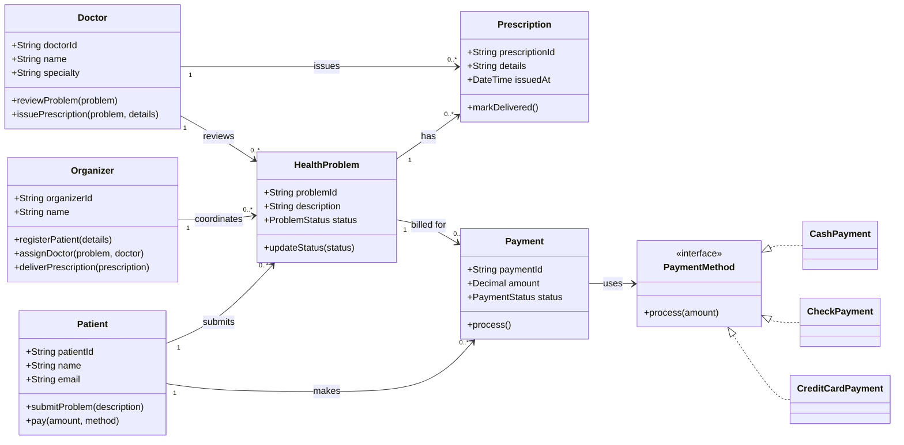
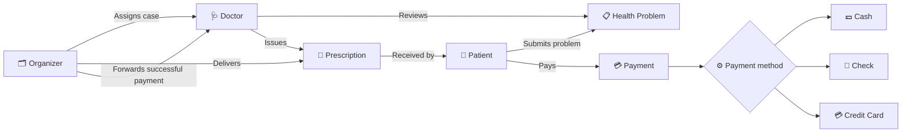
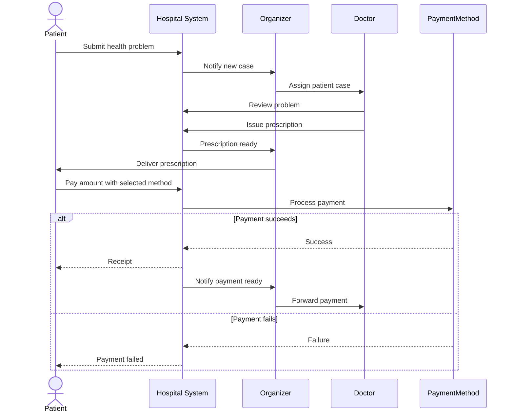
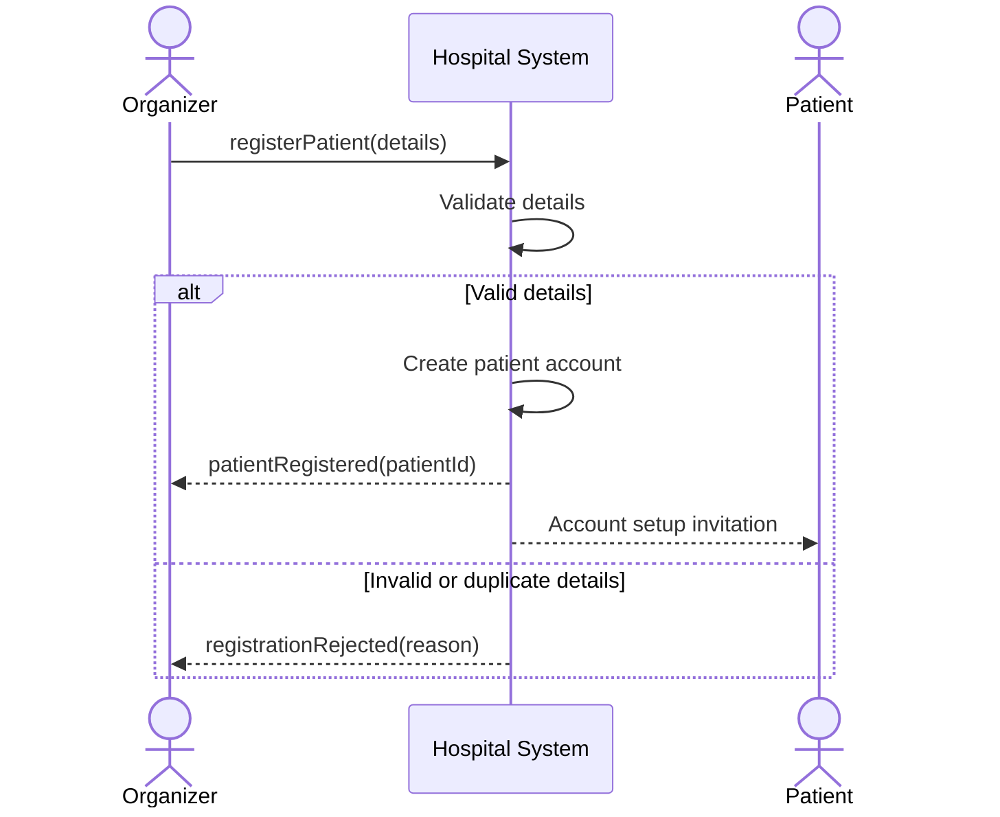

# Exercise 4 — Hospital Management UML (Visual Diagrams)

This is the **visual version** of the existing Hospital Management UML exercise:
[full written UML solution](../UML_Exercise_1_Hospital_Management.md).

GitHub displays the Mermaid blocks below as diagrams (rather than just code).
The icons identify the roles and major domain objects.

## 1. Class diagram: main entities and relationships

## 2. Icon-based overview (who does what)

## 3. Sequence diagram: consultation and payment

## 4. Sequence diagram: patient registration

## Notes

- This is a UML design exercise, not a production healthcare application.
- A consultation case has one active doctor and one coordinating organizer at a time; the full solution discusses how to extend the model for multiple consultations.
- Payment methods illustrate the Strategy design pattern.
