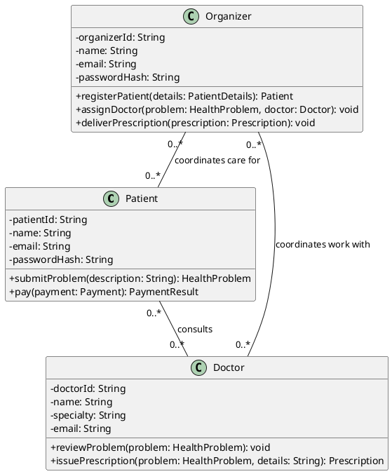
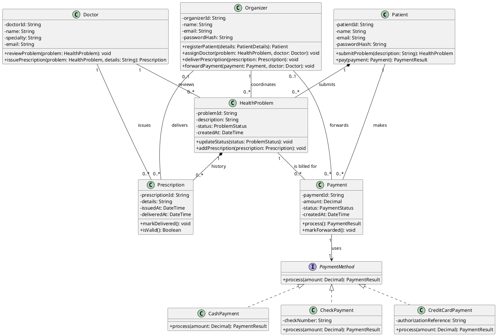
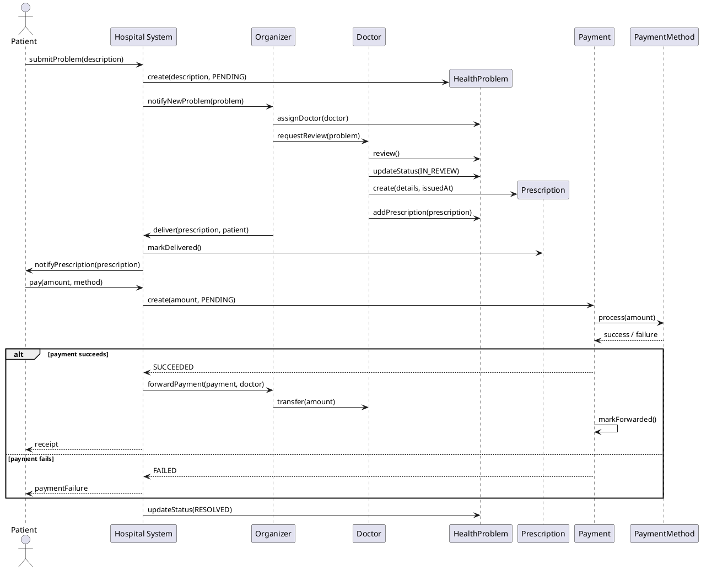
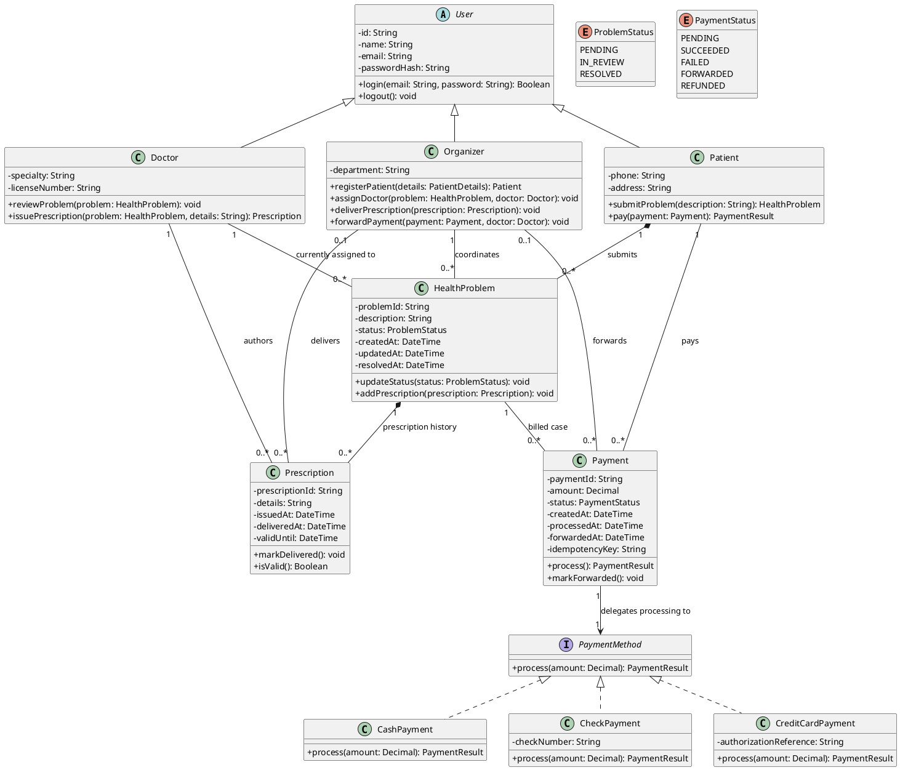
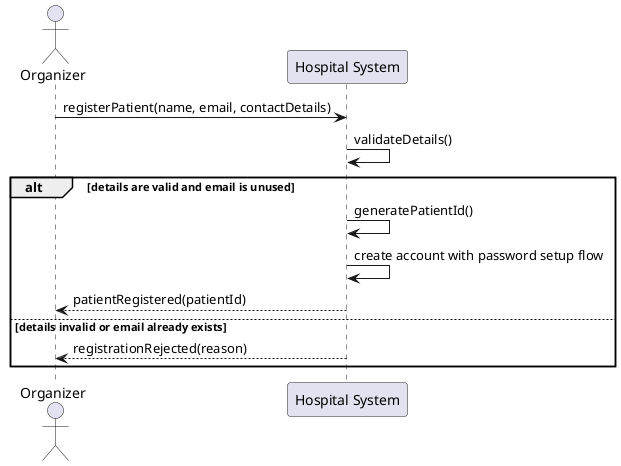
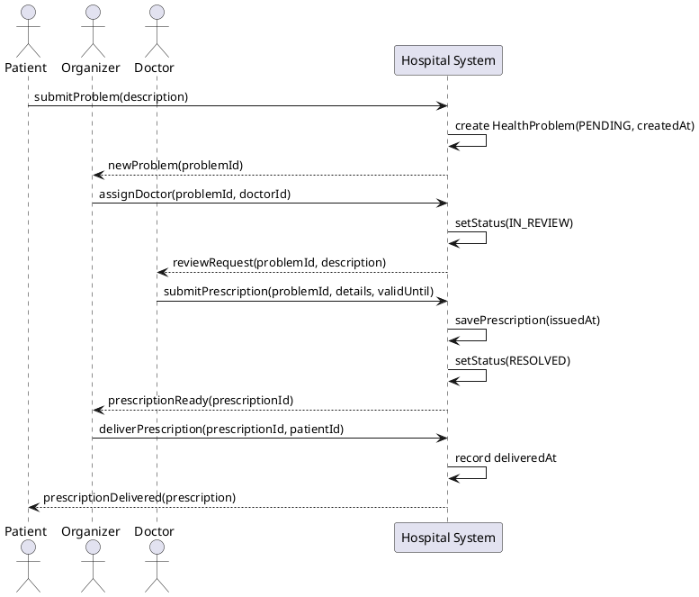
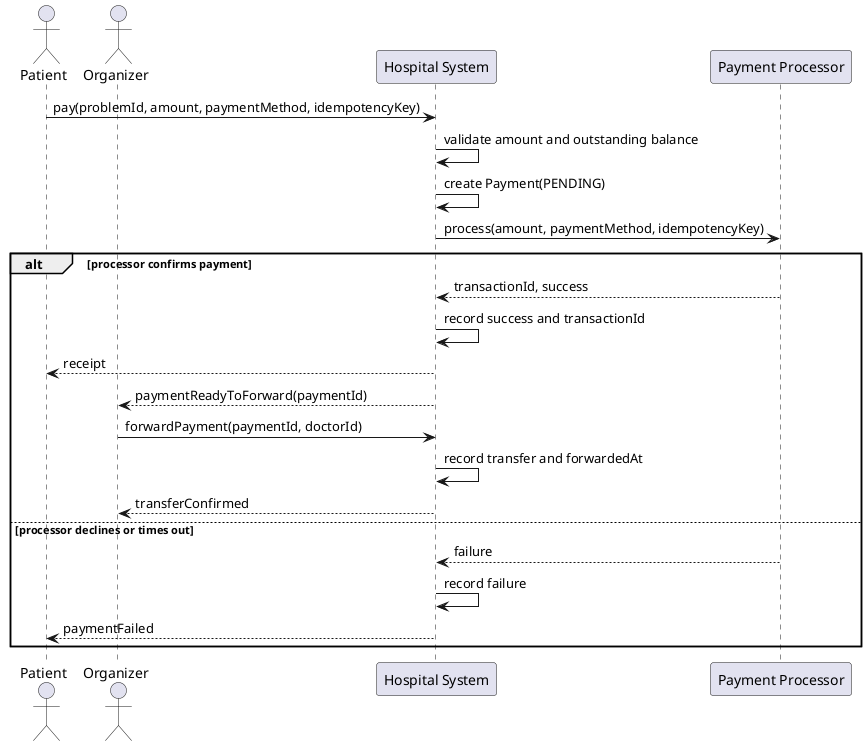

# UML Exercise 1 — Hospital Management System

Solution for Tasks 1–3 from the course UML practice: initial class diagram, expanded model and consultation sequence, advanced model and system sequence diagrams.

## Task 1 — Initial class diagram

The first model has the three requested roles. The associations are refined into case-specific relationships in Task 2.

## Task 2 — Complete class diagram and consultation sequence

The six required core classes are Patient, Doctor, Organizer, HealthProblem, Prescription, and Payment. PaymentMethod plus its concrete implementations model Check, Cash, and CreditCard. Each case has one active doctor and one coordinating organizer; it can have several prescriptions and payment attempts over its history.

### Sequence — patient submits a problem, receives a prescription, and pays

## Task 3 — Advanced class model

This version adds the shared User superclass, status tracking, timestamps, prescription history and polymorphic payment strategies. Passwords are stored as hashes; card details are handled by a payment provider rather than retained by the hospital system.

### System sequence — patient registration

The system should send a password-setup invitation instead of a reusable plaintext password.

### System sequence — consultation

### System sequence — payment and forwarding

## Design questions

1. **One patient consults multiple doctors:** keep one HealthProblem case and add a Consultation association class between HealthProblem and Doctor. Store each assignment, review note, and outcome there so earlier consultations are retained.
2. **Prescription reuse:** do not reuse a prescription as a new order. Create a separate refill prescription linked to the original with a `refillsPrescriptionId`.
3. **Payment pattern:** use Strategy. Payment delegates to PaymentMethod, and CashPayment, CheckPayment, and CreditCardPayment implement the same operation polymorphically.
4. **Payment integrity:** use a unique idempotency key to prevent duplicate charges, persist provider transaction references, allow only valid status transitions, and atomically record each successful payment and forwarding. Reconcile uncertain transactions with the provider before retrying.

## Assumptions

- One organizer coordinates each case, and one doctor is the active assignee at a time. The Consultation association class can preserve a multi-doctor history.
- A case can have several prescriptions over time. Each issued prescription is immutable; corrections or refills create a new record.
- Payment method strategies do not store card data in the hospital system.
